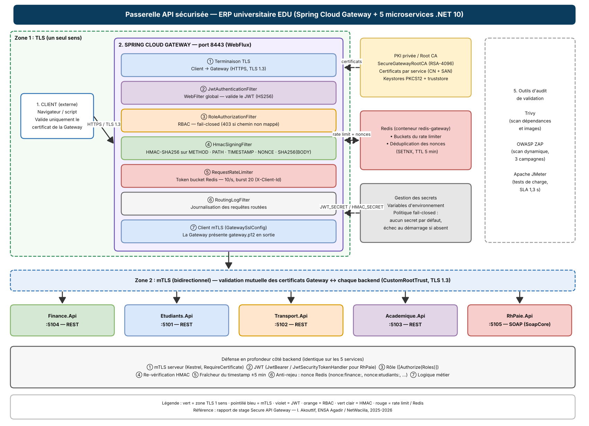

# Secure API Gateway for Microservices

Security layer for a Spring Cloud Gateway protecting 5 .NET microservices.
Built during my internship at NetWaciila (2026).



## My contribution (security layer)
- Private PKI (RSA-4096 Root CA, per-service certs) + end-to-end mTLS
- JWT authentication (gateway filter + validation on each backend)
- Fail-closed RBAC (role matrix at gateway + `[Authorize(Roles)]`)
- HMAC-SHA256 request signing + Redis nonce anti-replay (±5 min)
- Redis token-bucket rate limiting; no hard-coded secrets

## Team scope (not mine)
Gateway routing config and CI/CD: @Hafidamesad

## Security controls
| Threat (STRIDE) | Control | Implementation | Test |
|---|---|---|---|
| Spoofing | mTLS + JWT | `security/pki`, gateway filter | invalid cert / expired token → 401 |
| Tampering | HMAC-SHA256 | request signature | altered body → rejected |
| Repudiation | [..] | [..] | [..] |
| Info disclosure | TLS, no secrets in repo | [..] | Trivy / ZAP |
| DoS | rate limiting | Redis token bucket | JMeter: [..] |
| Elevation of privilege | fail-closed RBAC | role matrix | wrong role → 403 |

## Test results
| Tool | Scope | Result |
|---|---|---|
| Trivy | 5 images | CVEs: [before] → [after]; non-root images |
| OWASP ZAP | 3 passes (1 authenticated) | [findings summary] |
| JMeter | 4 scenarios | SLA 1.3 s: [result]; latency peaks: [..] |
| Replay / RBAC protocol | per service | correct role, denied role, unmapped route, admin override |

## How to run
```bash
docker compose up --build
# test: curl --cert client.crt --key client.key ...
```
(PKI keys are generated locally by `security/pki/generate.sh`, never committed.)

## Report
[Technical report (PDF)](docs/report.pdf)
